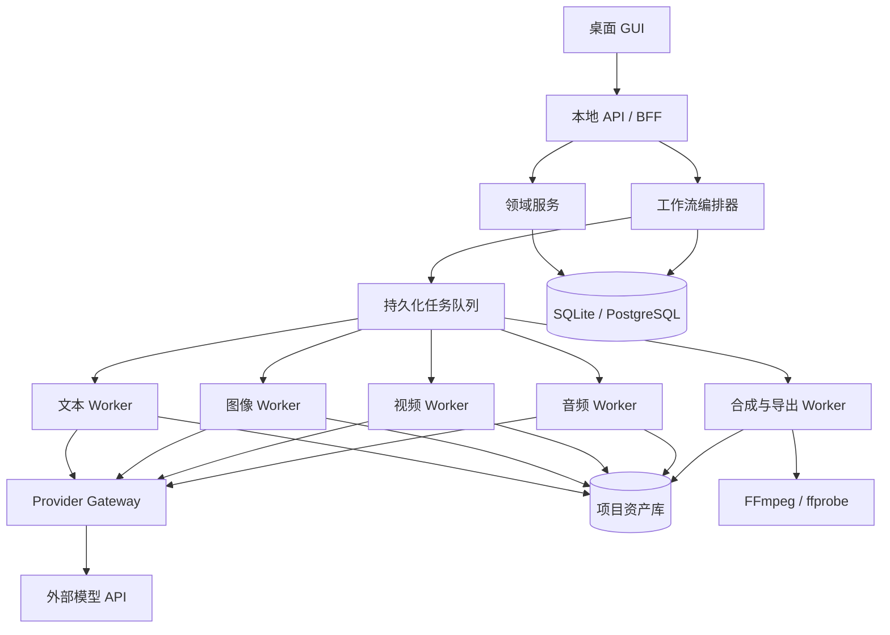
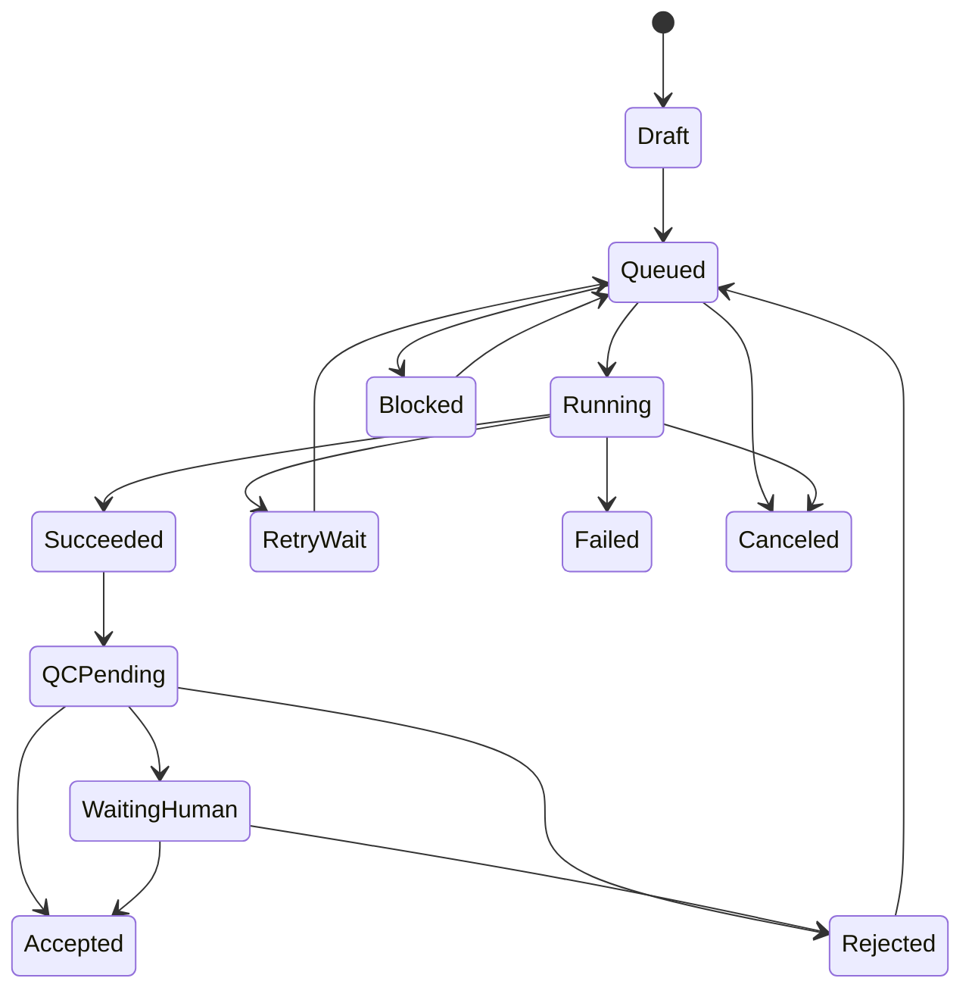

# 系统技术架构

## 1. 架构选择

首版建议采用：

> **Tauri 桌面壳 + React/TypeScript GUI + Python 本地服务 + SQLite + 本地文件资产库 + Redis 可选 + FFmpeg**

原因：

- 桌面端易访问大文件、FFmpeg 和剪映草稿目录；
- Tauri 安装包相对轻，前端生态成熟；
- Python 适合 AI Provider SDK、媒体分析和工作流逻辑；
- SQLite 适合单用户本地 MVP，后续可迁移 PostgreSQL；
- 前后端通过稳定 API 协议解耦，未来可替换成远程服务。

备选方案是 Electron + Node.js 全栈。若团队更熟悉 TypeScript，可把本地服务改为 Node.js，但领域边界和数据协议不变。

## 2. 分层架构



## 3. 模块边界

### 3.1 GUI

- 项目、剧本、圣经、分镜、资产、时间线和导出页面；
- 通过 REST 提交命令；
- 通过 WebSocket/SSE 获取任务进度；
- 不直接持有 Provider 密钥；
- 不直接调用云端模型。

### 3.2 API/BFF

- 参数校验；
- 聚合 GUI 所需数据；
- 提交工作流和用户命令；
- 返回影响分析、估价和预检结果；
- 不同步等待长任务完成。

### 3.3 领域服务

建议按模块组织，而不是首版拆微服务：

- Project；
- Story/Script；
- Bible/Asset Definition；
- Episode/Scene/Shot；
- Media Asset；
- Timeline；
- Review/Approval；
- Cost/Budget；
- Export。

### 3.4 工作流编排器

负责：

- 将阶段计划展开为 DAG；
- 判断依赖是否满足；
- 创建任务 attempt；
- 恢复、取消和重试；
- 人工审核节点；
- 预算检查；
- 上游变更后的失效传播；
- 汇聚批量镜头任务。

### 3.5 Worker

按资源和限流特征隔离：

- LLM Worker；
- Image Worker；
- Video Worker；
- Speech/Music Worker；
- QC Worker；
- FFmpeg Worker；
- Export Worker。

MVP 可运行在同一进程的多个工作线程/子进程中，但任务协议应支持未来独立部署。

### 3.6 Provider Gateway

统一认证、参数映射、上传、轮询、回调、错误分类、成本归一和结果下载。业务代码只调用 `text.generateStructured`、`image.generate` 等能力。

## 4. 推荐技术栈

| 层 | 首选 | 说明 |
|---|---|---|
| 桌面壳 | Tauri 2 | 本地文件与系统能力、安装包较轻 |
| GUI | React + TypeScript | 组件生态与复杂状态管理成熟 |
| UI 组件 | Ant Design 或 shadcn/ui | 首版统一选一种 |
| 状态/请求 | TanStack Query + Zustand | 服务端状态与本地 UI 状态分离 |
| 时间线 | 自研轻量轨道组件 + Canvas | 不在 MVP 实现完整 NLE |
| 本地 API | FastAPI | Schema、异步接口、Python AI 生态 |
| 数据访问 | SQLAlchemy + Alembic | 可迁移 SQLite/PostgreSQL |
| Schema | Pydantic + JSON Schema | LLM 结构化输出校验 |
| 任务 | 数据库持久队列（MVP） | 后续升级 Redis/Celery/Arq |
| 媒体 | FFmpeg/ffprobe | 确定性合成和探测 |
| 数据库 | SQLite WAL | 单用户本地优先 |
| 资产 | 本地内容寻址目录 | 后续可抽象 S3/MinIO |
| 日志 | structlog + JSON 日志 | 关联 project/task/attempt |
| 密钥 | OS Keychain | Windows Credential Manager 等 |

## 5. 进程模型

```text
V-Maker Desktop
├── Tauri 主进程
├── WebView GUI
├── Local API 子进程
├── Worker Pool
└── FFmpeg 子进程
```

启动时：

1. 桌面壳选择空闲本地端口并启动 API；
2. API 打开数据库并执行迁移；
3. 恢复上次异常中断的任务；
4. Worker 领取可运行任务；
5. GUI 连接事件流。

退出时：

- 停止领取新任务；
- 尝试取消可取消的远端任务；
- 持久化运行状态；
- FFmpeg 安全中止；
- 下次启动将 `RUNNING` 任务转入恢复检查，而不是直接视为成功或失败。

## 6. 任务 DAG

典型 DAG：

```text
StoryNormalize
  → BibleDraft → HumanReview
  → EpisodeOutline → HumanReview
  → ScriptGenerate → ScriptLint
  → ShotBreakdown
  → [KeyframeGenerate → VisualQC → VideoGenerate → VideoQC] × N
  → [TTSGenerate → AudioQC] × Dialogue
  → TimelineAssemble
  → PreviewRender → HumanReview
  → FinalRender → FinalQC
  → ExportMP4 / ExportJianying
```

关键规则：

- 镜头分支可以并行；
- TTS 可在对白锁定后提前执行；
- `TimelineAssemble` 可使用占位素材生成粗剪；
- 正式渲染只能消费批准或明确自动批准的版本；
- 一个镜头失败不取消其他镜头；
- 任务输入保存不可变快照与哈希。

## 7. 任务状态机



`Succeeded` 只代表 API 或程序执行成功，不代表作品质量合格；必须与 `Accepted` 区分。

## 8. 幂等、缓存与恢复

### 幂等键

```text
capability
+ provider/model version
+ normalized parameters
+ input asset hashes
+ prompt template version
+ bible snapshot version
```

同一幂等键可复用结果，但用户可以选择强制生成新变体。

### 恢复策略

- 外部异步任务：保存 provider job ID，重启后继续查询；
- 本地渲染：保存阶段清单，分段产物通过哈希校验；
- 回调：验签、去重，使用 attempt ID 做 compare-and-swap；
- 超时任务：先查询远端状态，不盲目重复提交。

## 9. 资产目录

建议每个项目自包含：

```text
project-root/
├── project.vmaker.json
├── db/                 # 可选项目级数据库或导出快照
├── source/             # 用户原始输入
├── assets/
│   ├── originals/
│   ├── generated/
│   ├── proxies/
│   └── derived/
├── cache/
├── timelines/
├── exports/
├── logs/
└── manifests/
```

文件名可读，但内部引用以资产 UUID 和内容哈希为准。禁止把大型媒体 BLOB 写入 SQLite。

## 10. API 轮廓

```text
POST   /projects
GET    /projects/{id}
POST   /projects/{id}/analyze
GET    /projects/{id}/episodes
PUT    /shots/{id}
POST   /shots/{id}/generate-keyframes
POST   /shots/{id}/generate-video
POST   /workflow-runs
POST   /tasks/{id}/retry
POST   /reviews/{id}/approve
GET    /events                  # SSE/WebSocket
POST   /timelines/{id}/render
POST   /exports
GET    /exports/{id}/report
```

批量修改采用命令接口，先提供 `dry_run=true` 返回影响范围与估价。

## 11. 可观测性

每个任务记录：

- correlation ID；
- 项目/集/场/镜头；
- Provider/model；
- attempt；
- 输入输出哈希；
- 开始/结束/等待时间；
- 预估与实际成本；
- 标准错误类型；
- 原始响应的安全引用。

日志必须脱敏，不记录 API Key、完整身份凭据或不必要的私人文本。

## 12. 后续扩展

- SQLite → PostgreSQL；
- 本地目录 → S3/MinIO；
- 数据库队列 → Redis/RabbitMQ；
- 单机 Worker → 多机资源池；
- 单用户 → 工作区和 RBAC；
- 内置 Provider → 插件 SDK；
- 桌面 GUI → Web 审核端。

这些扩展不应改变 Project、Shot、Asset Version、Task 和 Timeline IR 的核心协议。
